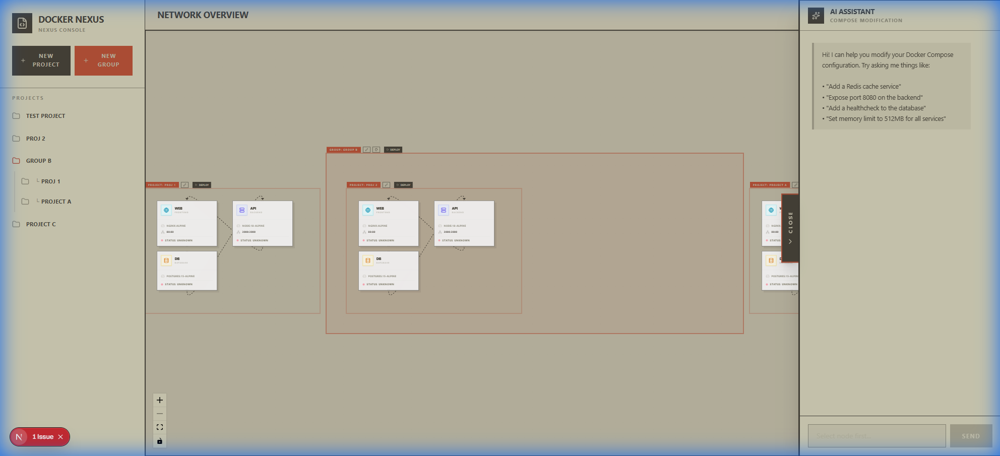

# Docker Nexus ⚓

> **The definitive Docker Compose manager for your home lab.** Visualize, manage, and evolve your services with AI-assisted precision.



## Why Docker Nexus?

Docker Nexus is built for **simple home server setups** and personal app hosting.

Managing a home server can be messy. Terminal commands are great, but sometimes you just want to **see** what's running. Docker Nexus gives you a beautiful, interactive dashboard to:

*   **Manage & Monitor**: Track health, logs, and status of all your containers in real-time.
*   **Organize**: Group related services, ungroup them, or merge multiple Compose files into logical stacks.
*   **Simplify**: Control your infrastructure without the overhead of Kubernetes.
*   **AI Assistance**: Use the built-in AI to modify settings just by asking.

## ✨ Key Features

*   **🕸️ Interactive Graph**: A persistent, visual map of your entire infrastructure. Drag nodes, organize groups, and see the big picture.
*   **📝 Live Editor**: Edit `docker-compose.yml` files directly in the browser with syntax highlighting.
*   **🤖 AI Assistant (MCP)**: Use natural language to modify your stacks. Powered by the Model Context Protocol.
*   **📊 Real-time Monitoring**: View container logs and status updates instantly.
*   **🏠 Home Lab Ready**: Simple to deploy on any server running Docker.

## 🚀 Quick Start

Get up and running in seconds.

```bash
# Clone the repo
git clone git@github.com:vedantprajapati/Docker-Nexus.git

# Enter directory
cd Docker-Nexus

# Start the application
docker compose up -d

# Open your browser
# http://localhost:3000
```

## 📚 Documentation

Check out our full documentation for detailed guides on:
*   [**Deployment**](https://vedantprajapati.github.io/Docker-Nexus/docs/deployment)
*   [**MCP Server API**](https://vedantprajapati.github.io/Docker-Nexus/docs/mcp-server)
*   [**UI Walkthrough**](https://vedantprajapati.github.io/Docker-Nexus/docs/ui-walkthrough)

## ⚙️ Configuration

Docker Nexus works out of the box, but you can turbocharge it with your favorite AI provider.

| Variable | Description | Default |
|----------|-------------|---------|
| `LLM_PROVIDER` | `openai`, `ollama`, `anthropic`, or `gemini` | `ollama` |
| `OPENAI_API_KEY` | OpenAI API key | - |
| `ANTHROPIC_API_KEY` | Anthropic API key | - |
| `GEMINI_API_KEY` | Google Gemini API key | - |
| `OLLAMA_URL` | Ollama server URL | `http://host.docker.internal:11434` |

## License

MIT © [Vedant Prajapati](https://github.com/vedantprajapati)
