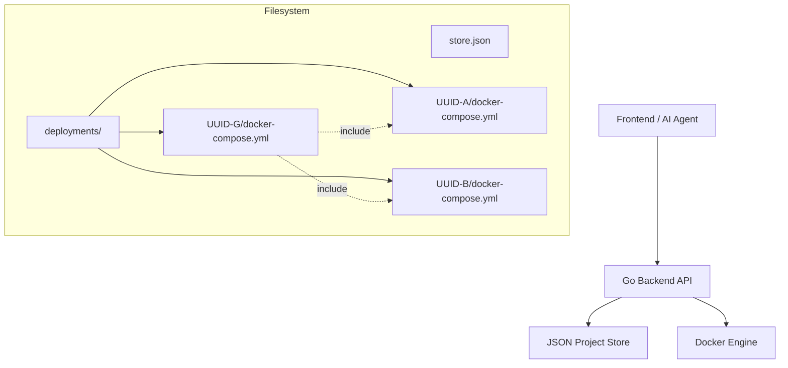

# Docker Nexus Architecture

## Overview
Docker Nexus is a modern Docker Compose management interface that provides a visual and AI-augmented experience for managing local development stacks. It uses a **Frontend** (Next.js) for the UI and a **Backend** (Go Fiber) for orchestration.

## Core Concepts

### 1. Projects
A "Project" is the fundamental unit. It represents a single `docker-compose.yml` configuration.
- Stored in `store.json`.
- Identified by a UUID.
- Materialized to `deployments/{UUID}/docker-compose.yml` upon deployment.

### 2. Groups (New)
A "Group" is simply a Project that uses the **Docker Compose `include`** feature to bundle other projects.
- **Mechanism**: The parent project's `docker-compose.yml` lists child projects in an `include` block.
- **Pathing**: Child projects are referenced via relative paths: `../{ChildUUID}/docker-compose.yml`.
- **Behavior**: Deploying the Group deploys the parent and all included children as a unified stack.
- **Isolation**: Child projects can still be deployed individually.

### 3. AI and MCP
The system exposes a **Model Context Protocol (MCP)** server over stdio. This allows AI agents (like Claude/Cursor) to:
- List projects.
- Deploy/Stop projects.
- **Create Groups**: Programmatically group projects together.
- Modify Compose files using an internal LLM service.

## Architecture Diagram

## Known Limitations (Flaws)

1.  **Referential Integrity**: Deleting a project that is included in a group will break the group's deployment (file not found).
2.  **Deployment Directory**: The system assumes a flat structure in `deployments/`. Moving files manually will break grouping.
3.  **Concurrency**: While individual file writes are atomic, complex multi-project restructuring via AI might race if not carefully orchestrated.

## API & CLI
- **API**: RESTful API at `/api/projects`.
- **MCP**: JSON-RPC over Stdio for agent integration.
