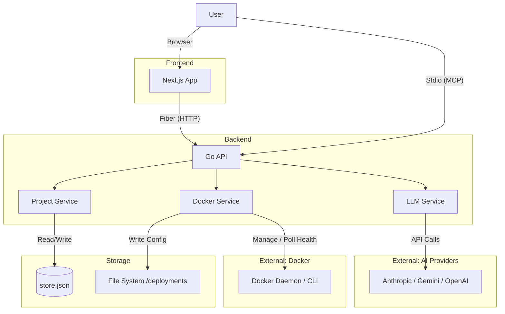

# System Architecture

Docker Nexus is designed as a modern, decoupled web application that leverages the power of the Docker CLI while providing a rich, interactive user interface.

## High-Level Overview

## Detailed Components

| Component | Technology | Description |
|-----------|------------|-------------|
| **Frontend** | Next.js 14 (App Router) | React-based UI with Zustand for state, React Flow for graph visualization, and Tailwind CSS for styling. |
| **Backend** | Go (Fiber) | REST API server + MCP interface. Exposes endpoints for projects, Docker, and LLM operations. |
| **Project Service** | Go | Manages project CRUD operations and persistence to `store.json`. |
| **Docker Service** | Go | Wraps the `docker compose` CLI for deploy, stop, status, and logs. |
| **LLM Service** | Go | Sends prompts to AI providers and validates returned YAML. |
| **Storage** | JSON File | `store.json` stores project metadata; `/deployments/` holds materialized Compose files. |

## Key Concepts

| Concept | Description |
|---------|-------------|
| **Execution Modes** | The backend runs in either **HTTP mode** (web server on port 8080) or **MCP mode** (stdio for AI agents). Set via `MCP_MODE` env var. |
| **Config Sync** | The process of writing virtual YAML from `store.json` to physical `docker-compose.yml` files in `/deployments/{id}/`. |
| **Live Tracking** | Status is polled via `docker compose ps`; logs are streamed via `docker compose logs -f` over SSE. |
| **LLM Integration** | User prompts + Compose context are sent to AI providers; returned YAML is validated before saving. |

## Deployment Strategy
Docker Nexus itself is containerized.
- **Frontend Container**: Nginx serving static export or Node.js server.
- **Backend Container**: Alpine-based Go binary.
- **Docker Socket**: The host's `/var/run/docker.sock` is mounted into the backend container, giving it control over the host's Docker daemon.
